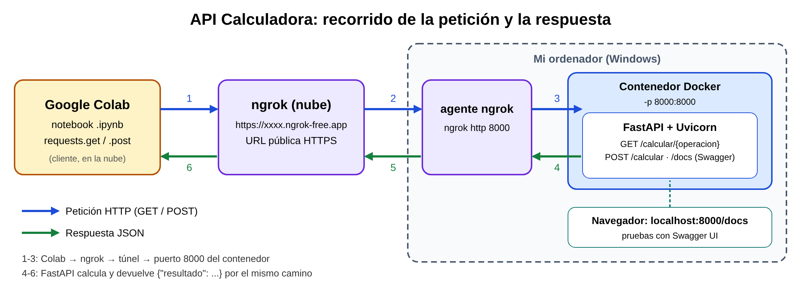
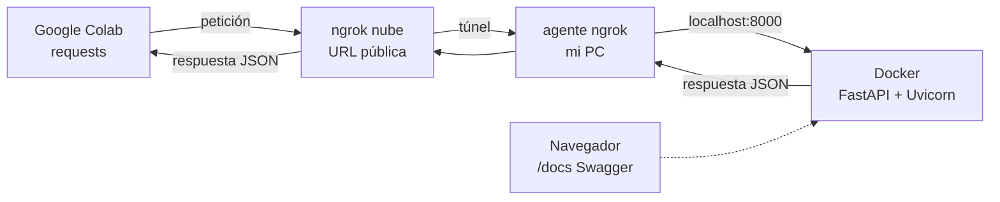

# API Calculadora con FastAPI, Docker, Swagger y ngrok

## Objetivo

Crear una API sencilla con **FastAPI**, ejecutarla dentro de un contenedor **Docker**, probarla con **Swagger** (`/docs`), exponerla a Internet con **ngrok** y consumirla desde un notebook de **Google Colab** usando `requests`.

La API es una calculadora: suma, resta, multiplica o divide dos números.

## Estructura del proyecto

```
calculadora-api/
├── app/
│   └── main.py              # Código de la API (FastAPI)
├── notebook/
│   └── consumir_api.ipynb   # Notebook de Colab que llama a la API vía ngrok
├── docs/
│   ├── diagrama.png         # Diagrama de componentes y flujo
│   ├── diagrama.svg
│   └── capturas/            # Capturas de Swagger y Colab
├── Dockerfile
├── requirements.txt
└── README.md
```

## Endpoints

| Método | Ruta | Parámetros | Descripción |
|---|---|---|---|
| GET | `/` | — | Mensaje de bienvenida y lista de operaciones |
| GET | `/calcular/{operacion}` | `operacion` en la ruta; `a` y `b` en la URL | Calcula con parámetros de la URL |
| POST | `/calcular` | JSON `{"a", "b", "operacion"}` | Calcula con los datos del cuerpo JSON |

Operaciones válidas: `sumar`, `restar`, `multiplicar`, `dividir`.

### Ejemplos

**GET** `/calcular/sumar?a=5&b=3`

```json
{"operacion": "sumar", "a": 5.0, "b": 3.0, "resultado": 8.0}
```

**POST** `/calcular` con el cuerpo:

```json
{"a": 8, "b": 2, "operacion": "dividir"}
```

Respuesta:

```json
{"operacion": "dividir", "a": 8.0, "b": 2.0, "resultado": 4.0}
```

**Errores:** dividir entre 0 devuelve `400 {"detail": "No se puede dividir entre 0"}`. Una operación que no existe (por ejemplo `potencia`) devuelve `422`.

## Requisitos

- [Docker Desktop](https://www.docker.com/products/docker-desktop/) en marcha
- Una cuenta gratuita de [ngrok](https://dashboard.ngrok.com/signup) y el programa `ngrok` instalado
- Una cuenta de Google para abrir el notebook en Colab

## Construir y ejecutar el contenedor

Desde la carpeta del proyecto (en PowerShell o CMD):

```bash
docker build -t calculadora-api .
docker run -d --name calculadora -p 8000:8000 calculadora-api
```

Comprobar que funciona: abre <http://localhost:8000> en el navegador.

Para pararlo y borrarlo:

```bash
docker stop calculadora
docker rm calculadora
```

## Probar con Swagger (`/docs`)

1. Abre <http://localhost:8000/docs>.
2. Despliega un endpoint, pulsa **Try it out**, rellena los datos y pulsa **Execute**.
3. Revisa el código de respuesta (200) y el JSON devuelto.


## Exponer la API con ngrok

1. Instala ngrok (en Windows: `winget install ngrok.ngrok`, o descárgalo desde la web).
2. Configura tu token **una sola vez** (cópialo desde el panel de ngrok; nunca lo subas al repositorio):

   ```bash
   ngrok config add-authtoken TU_TOKEN
   ```

3. Con el contenedor en marcha, abre el túnel hacia el puerto 8000:

   ```bash
   ngrok http 8000
   ```

4. Copia la URL que aparece en `Forwarding`, del estilo `https://xxxx.ngrok-free.app`.

> El túnel solo funciona mientras esa ventana está abierta, y la URL puede cambiar cada vez que lo arrancas.

## Usar el notebook en Colab

1. Abre [Google Colab](https://colab.research.google.com/) → **Archivo → Subir cuaderno** → `notebook/consumir_api.ipynb`.
2. En la primera celda de código, pega tu URL de ngrok en `BASE_URL`.
3. Ejecuta todas las celdas (**Entorno de ejecución → Ejecutar todas**).
4. Guarda el notebook con las salidas visibles (**Archivo → Descargar → .ipynb**) y sustituye el del repositorio.


## Diagrama



1. Colab envía la petición HTTP (`requests.get` / `requests.post`) a la URL pública de ngrok.
2. La nube de ngrok la reenvía por el túnel al agente ngrok de mi ordenador.
3. El agente la entrega en `localhost:8000`, que Docker conecta con el puerto 8000 del contenedor.
4. FastAPI procesa la petición y genera la respuesta JSON.
5. La respuesta vuelve por el túnel a ngrok.
6. ngrok se la entrega a Colab, que la muestra.


